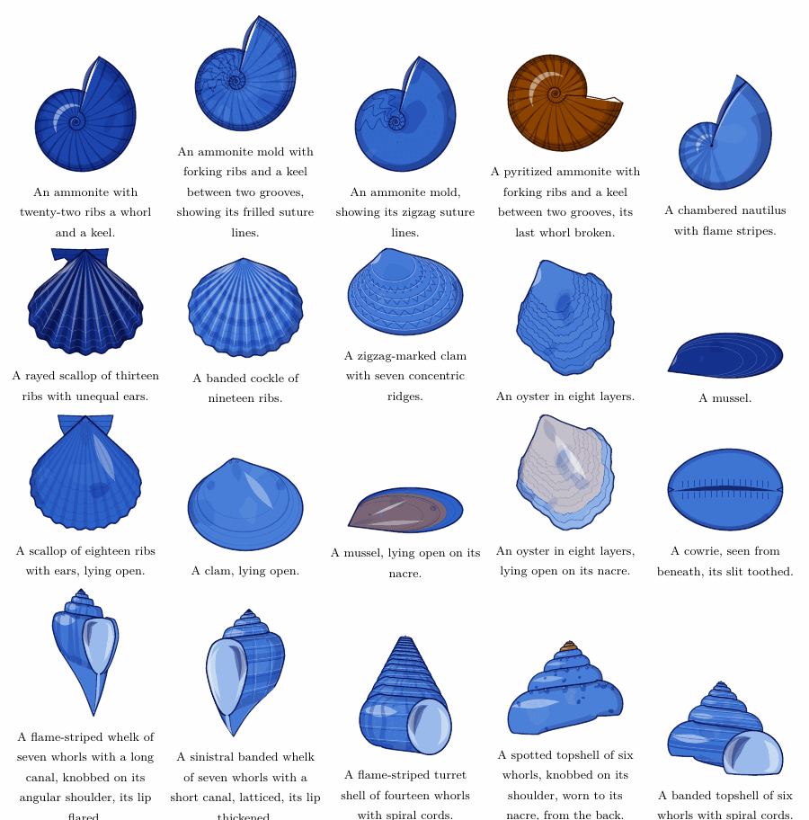

# Shells



Since 2.1.0 the margin has shells as well as plants. A shell is sampled from a genome of its
own, the way a plant is: an ammonite or a nautilus, a scallop, cockle, mussel, clam or oyster,
a whelk, turret shell or topshell, or a cowrie. Each document has a cabinet of four, and on
some pages a few of them lie on the ground at the foot of the plants, as the Dutch flower
painters laid shells beside their bouquets. The shells theme gives them the whole margin. The
same shells are TikZ pics, drawn in pure TikZ under pdfLaTeX.

## A shell's genome

A shell has 32 traits, sampled in a fixed order from pgf's generator. One seed is one shell, in
Lua and in TikZ alike ([the traits](traits.md) lists them all). The first trait is the kind,
chosen by the shell's role, and the kind sets its group.

| group | kinds | how it is seen |
|---|---|---|
| `planispiral` | `ammonite`, `nautilus` | from the side, down the axis it coils round |
| `bivalve` | `scallop`, `cockle`, `mussel`, `clam`, `oyster` | one valve, its beak up, from the outside or lying open |
| `gastropod` | `whelk`, `turret`, `topshell`, `cowrie` | from the side with the axis upright, mouth or back to us; a cowrie from above or beneath |

The roles are `margin` (the kinds that read well small, for the margin's cabinet), `ornament`,
a group, `any`, or a kind. Then come what every shell has: its real size in millimeters, its
tone and ground (the ink's, pale, dark), a color pattern (bands, rays, flame stripes, zigzags,
spots) and its strength, how it is seen, and how it is preserved (a shell, a mold showing its
suture lines, pyrite, worn through to the nacre). After that each group's own traits follow.
For a coil those are David Raup's numbers: how many whorls, how fast the tube widens each turn
(W), how far its inner edge stands from the axis (D), and how far the coil is drawn down the
axis for a spire (T). Then the sculpture (ribs, forking or knobbed, spiral cords, a lattice,
knobs on the shoulder, concentric ridges, an oyster's layers), an ammonite's keel and its kind
of suture line, a broken last whorl, a valve's outline and ears, a whelk's shoulder, canal, lip
and the folds on its columella, and the hand it coils to.

Rules keep a shell possible. A coil has W over 1 and D from 0 up to 1, and its whorls touch,
which is W times D at most 1. Only a whelk or a turret shell coils to the left. Only an
ammonite is a mold or pyrite, and suture lines show only on a mold. Only a whelk has a canal and
folds, and only a cowrie a toothed slit. Every shell can say what it is, through
`florilegium.shdescribe`:

> A flame-striped whelk of seven whorls with a short canal, knobbed on its shoulder.
>
> An ammonite mold with thirty-six ribs a whorl, showing its saw-toothed suture lines.

## On the page

On one page in three of the species garden, one to three of the document's cabinet lie on
the ground, beside the root or along the band at the foot of the page. Each is sized from its
real size, from 6 mm to 15 mm, so it stays in scale with the plants, and tilted as it fell: a
coil or a cowrie nearly upright, a valve tipped over, a spired shell lying on its side. A soft shadow
falls to its lower right. They lie under the stems, so the footer's vine and its leaves pass in
front of them. The cabinet is drawn once for the whole document, four shells of different
kinds from at least two groups and at most one in the copper, so a reader sees the same
collection come back. A page without shells is the same page as before, and the option
`noshells` leaves them out everywhere.

`\florilegiumornament` takes `scallop`, `ammonite`, `nautilus`, `whelk` and `cowrie`, each a
shell of that kind sampled from the ornament's seed.

With `theme=shells` the margin is shells and nothing else: strands of wrack from a pebble in
the corner, the cabinet low beside them, and the page's own shells gathering along the wrack.
[Themes](themes.md#shells) describes it.

## In TikZ

```latex
\usetikzlibrary{florilegium}
\pic {florilegium shell={seed=3, role=ammonite, size=3cm}};
\pic {florilegium shell={seed=3, role=scallop, size=3cm, traits={view=inside}}};
\florilegiumshell{3}{any}   % sample one without drawing it, then
\florilegiumshelltrait{kind}
```

The pic draws a shell centered on the y axis with its base on the x axis, `size` across at
most. Under LuaLaTeX `florilegium-shell.lua` draws it in a fraction of a second. Under pdfLaTeX
pgfmath draws the same shell step for step in one to six seconds, the ammonites the longest.
The two agree within a pixel at 150 dpi (`tools/tikzcheck.lua draw shells`). Page 10 of
`specimen-tikz.pdf` shows every kind.

## How it is drawn

A coil is Raup's tube. Each turn the ring is W times larger and turned a full turn about the
axis, so a ring a degrees along the coil is W to the power a/360 times the first. Its place
follows Okabe and Yoshimura, who start from a ring of radius 1 centered y0 from the axis,
y0 = (1 + D)/(1 − D), and x0 = T y0 down it.

An ammonite or a nautilus is seen down its axis, so it is flat drawing. A whorl is the band
between two spirals, and the next whorl, W times wider, covers its outer part as far as D lets
it. What shows of each whorl is the band from its own inner edge to the next whorl's, so the
bands tile the disc and the line between two of them is one spiral. Each band is washed,
shaded along both edges and lit on its upper left, then gets its ribs, a nautilus's flame
stripes or a mold's suture lines, which are lobes and saddles across the band, as deep as they
are wide, zigzag, toothed or frilled by kind.

A valve is drawn from its outline. The outline is an ellipse and the beak, joined by the two
lines from the beak that just touch the ellipse. A beak well above it makes a scallop's fan,
one just over it a cockle's or a clam's rounded umbo, and one low at an end a mussel's wedge.
A valve grows at its edge, so a growth line is the margin shrunk toward the beak. A rib runs
from the beak to the margin and scallops it. Inside, a valve shows its rim, the line where the
mantle met it, the muscle scars, the hinge's teeth and, for a mussel or an oyster, nacre in
the copper.

A whelk, turret shell or topshell stands with its axis upright, turned a little so its mouth
faces forward. Each whorl shows the front half of its turn. Painted oldest first, each whorl's
top edge is the suture on the whorl above. The mouth is seen face on, porcelain going dark
into the shell. A whelk's ring is an egg drawn down to its canal. A cowrie has no coil to
draw: it is a glossy egg, spotted or banded from above, its toothed slit from beneath.

How much is drawn follows the shell's size on the page. Under 12 mm there is no mottle and no
suture lines, and under 5 mm only the wash and the lines.

## Sources

- The coil is David M. Raup's model, from *Geometric analysis of shell coiling: general
  problems* (Journal of Paleontology, 1966).
- The ring's place follows Takuya Okabe and Jin Yoshimura's reparameterization of it, in
  *Optimal designs of mollusk shells from bivalves to snails* (Scientific Reports, 2017).
- The rule that the whorls touch, W times D at most 1, is as George R. McGhee states it in
  *Limits in the evolution of biological form* (Interface Focus, 2015).
- Shells beside flowers are an old idea: Balthasar van der Ast painted them, as in his
  *Flowers in a Wan-Li Vase, with Shells* in the Mauritshuis.
- The kinds, their sculpture and the rest come from research notes made for this project, and
  nothing is traced from a plate.
