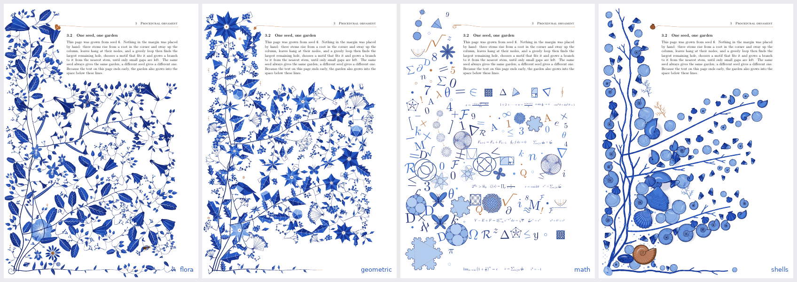
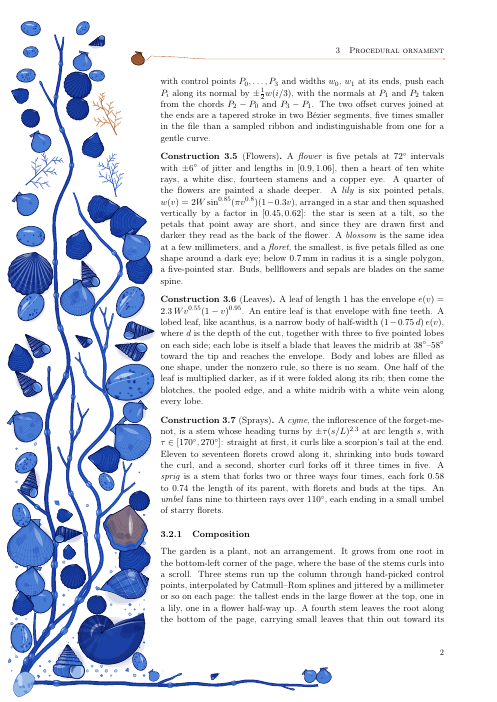

# Themes



*Seed 6 four times: the species garden, with `theme=geometric`, with `theme=math` and with `theme=shells`.*

```latex
\usepackage[grown,theme=geometric]{florilegium}   % or theme=math, theme=shells; the whole document
\florilegiumtheme{math}                            % or from the page this stands on
```

The growth loop never knew what it was drawing. It reads a table of motifs (the size of the
disc each one takes, a weight, a function that draws it) and calls every primitive by name. A
theme is one Lua file, `florilegium-theme-<name>.lua`, that replaces some of those primitives
and may add rows to the table, or brings a composition of its own. The geometric theme grows
v1.3's garden, with its hand-designed kinds, and draws it in its own way; the species belong to
the unthemed margin. The math and shells themes lay out the whole page themselves.

## Geometric

`theme=geometric` is v1.3's plant cut from flat shapes (`florilegium-theme-geometric.lua`). It
grows by v1.3's loop from v1.3's motifs, so the plant is v1.3's and the drawing is new; the
crystals among them take some of the room, so a seed's layout is not quite v1.3's. The stems
run straight between their nodes, the leaves are kites and toothed polygons folded into a light
and a dark facet with straight white veins, the flowers are rosettes of rhombi or layered star
polygons, the tendrils square spirals, the bird and the butterfly low-poly. The colors are flat
tones of the ink, with no wash, and crystals (Platonic solids, flat-shaded like cut stones) grow
among the flowers. A page's margin is about a tenth of the size of a v1.3 page's in the PDF, and a
sixteenth of a species page's (`florilegium-grow.tex`, measured 2026-11-05).


## Math

`theme=math` is no plant at all (`florilegium-theme-math.lua`, drawing from
`florilegium-figures.lua`). Mathematics cascades down the margin and across the bottom of the
page, overlapping a little so it blends. A large figure sits in the corner where the column
meets the bottom: an Apollonian gasket, a deep Koch snowflake, Vogel's disc, a polyhedron. Down
the column run one or two *families*, figures that change as they go, joined by small copper
arrows. The Koch snowflake gains a level, a polygon gains sides on its way to the circle, the
cube truncates into the octahedron, chords k → mk mod n turn from a cardioid into a nephroid,
and Vogel's disc packs evenly only at the golden angle.

Equations that hold (e^{iπ} + 1 = 0, V − E + F = 2, ...) run along the bottom and under the
text on the last page. Everything else, largest hole first, is figures (Platonic solids,
knots, Hilbert curves, Lissajous curves, hypotrochoids, Maurer roses, the Petersen graph, ...),
letters, numerals and symbols set by TeX at many sizes and a slight tilt, and dots. It fills
whatever space the page leaves, like the garden; `density` sets how much there is.


## Shells

`theme=shells` is no plant either (`florilegium-theme-shells.lua`). The margin is a strip of the
shore seen from above. Strands of wrack lie from a pebble in the corner up the column and along
the foot of the page. Each is a flat strap with a midrib that forks as it goes, with air bladders
in pairs and swollen tips, the way bladderwrack grows, and the shells lie among them.

Every shell is sampled from a genome, as a plant is, and drawn from it by
`florilegium-shell.lua`: an ammonite or a nautilus, a scallop, cockle, mussel, clam or oyster, a
whelk, turret shell, topshell or cowrie. The document's cabinet of four, the same four that lie on
the ground on some of the species garden's pages, lies lowest, the largest nearest the corner, so
a reader sees the same collection on every page. Then the page draws five kinds of its own and
lays them where there is room, largest hole first and those near the wrack first, as the
garden's flowers grow from its stems. They are large toward the corner and small up the column
and along the foot, they overlap a little, and now and then one is tucked half under its
neighbors. Which kind goes where follows how large it grows, and a kind gets rarer the more of
it there is. A tuft of fine weed in the accent, sometimes one or two more in the ink, and grit
and broken shell along the bottom finish the page. Each shell casts a soft shadow to its lower right. On a
mirrored page the shells are drawn the right way round, since a whelk's coil has a hand.

A small copper scallop stands beside each heading (option `sections`) and starts the head rule,
and `\florilegiumbloom[whelk]` lays a shell of that kind, or of a group (`planispiral`,
`bivalve`, `gastropod`). The theme has no seasons and no visitors; `density` thins it down to a
single strand and a few shells at `0.05`.



## Writing a theme

A theme returns its primitives by name, with the same arguments and frame as the ones they
replace (`flower(rng, s)` centered on its origin, `sprig(rng, L)` from its base along +y,
`leaf(rng, o)` one unit long along +y, scaled by its caller, ...), and a function that may
reweight the motif rows and add new ones:

```lua
-- florilegium-theme-<name>.lua
return {
  flora = { flower = function(rng, s) ... end, leaf = function(rng, o) ... end },
  motifs = function(rows, F) ... return rows end,
}
```

A theme with `page = function(g, grow)` gets the whole page instead and lays it out itself, as
`florilegium-theme-math.lua` and `florilegium-theme-shells.lua` do. `florilegium-theme-geometric.lua` is the example to start
from, and [CLAUDE.md](../CLAUDE.md) lists the rules a theme has to keep (the animation's,
mirrored pages', density's).
