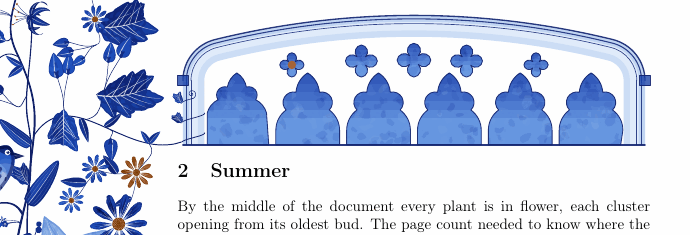

# Gothic tracery



Since 2.1.0 the margin draws stone as well as plants. A window of Gothic tracery is sampled
from a genome of its own, the way a plant is. It goes over a section heading as a headpiece,
a screen of lights under a flat arch. The garden sends a branch to it, and a vine twines up
the jamb. The same windows are TikZ pics, drawn in pure TikZ under pdfLaTeX, and a decorated
initial can open as a cusped arch.

## A window's genome

A window has 30 traits, sampled in a fixed order from pgf's generator. One seed is one window,
in Lua and in TikZ alike ([the traits](traits.md) lists them all). The first trait is the
kind, chosen by the window's role on the page. The second is the period, which sets most of
the rest, as a body plan sets a plant's.

| kind | role | what it is |
|---|---|---|
| `headpiece` | `headpiece` | a wide, shallow arch over five to eight lights, their cusped heads rising into it, small foils in the stone between them |
| `arcade` | `headpiece` | five to ten bays side by side under a straight molding, trefoils between them |
| `window` | `window`, `frame` | a tall window of one to seven lights, its head branching as its period does |
| `rose` | `rose`, `ornament` | spokes from a foiled eye to the rim, in one ring or two |
| `foil` | `ornament` | a foiled circle alone, three to eight lobes, round or pointed |

The periods are Rickman's names for English Gothic, with the French rayonnant and flamboyant
beside them. Each draws its own arches and heads.

- *Early English* has lancets and equilateral arches, plate tracery cut through the slab, and
  a single oculus or foiled circle in the head.
- *Geometric* has equilateral arches over sub-arches, with a foiled circle or a spherical
  triangle above them and trefoils in the spandrels. Its mullions may fork in a Y or cross.
- *Curvilinear* has drop and ogee arches, daggers, mouchettes and soufflets. The lights' ogee
  heads can repeat up the head as a net (*reticulated*), or mouchettes can *flow* in the head.
- *Perpendicular* has four-centered arches. The mullions run straight up to the arch through a
  row of panels, and transoms cross the lights.
- *Rayonnant* has equilateral arches over sub-arches and round foils in several orders.
- *Flamboyant* has ogee arches, flowing heads and pointed foils.

The rest follow in their order of sampling. The arch and its excess (radius over span). A
four-centered arch's rise and shoulders. The height of the jambs. How the lights split under
their sub-arches, in two halves, a center light with the rest each side, or one by one. How
deep the sub-arches go and how far they are set down. The widths of the bars and the border.
Transoms. The figure in the head and its foils. The cusps in each light's head and their
depth. The orders round the arch, the hood mold and its stops, what fills the spandrels, the
wash's tone, and where the copper goes.

Rules keep a window buildable. There are no more sub-arches than lights, no cusps on a
segmental head, transoms only in the Perpendicular, and a screen only on a headpiece. Every
window can also say what it is, through `florilegium.tdescribe`:

> A geometric window of three lights under a sexfoil, in an equilateral arch of two orders
> with a hood mold ending in stops, the lights trefoiled, trefoils in the spandrels.
>
> A Perpendicular headpiece of six lights paneled to the arch, in a four-centered arch,
> crossed by a transom, the lights cinquefoiled, foliage in the spandrels.

## On the page

```latex
\usepackage[grown,headpieces]{florilegium}   % a headpiece over every \section
...
\florilegiumheadpiece                         % or one here, by hand
\florilegiumheadpiece[seed=7, width=10cm, traits={period=perpendicular}, vine=none]
```

The option `headpieces` puts one over every `\section` and `\section*`. It goes after the
heading's space above and stays with its title on the page (standard classes).
`\florilegiumheadpiece` sets one where it stands, in a box as wide as the line with the sill
on the baseline. Its keys are `seed` (by default the k-th of the document, like an ornament),
`role` (`headpiece`, or `window`, `rose` and the rest for something else at that width),
`width`, `traits` (any of the genome's, fixed, as in [your own genome](tikz.md#a-genome-of-your-own))
and `vine`.

With the margin on, the headpiece is not drawn where the command stands. The command leaves
a mark, and the headpiece is drawn at shipout, when the page knows which side its margin is
on. A vine then twines up the jamb on that side, a helix seen side on round the shaft of
moldings, with the leaves of the nearest plant on it. That plant sends a branch from the
margin to the vine's foot. On the right-hand pages of a two-sided document it is the right
jamb. `vine=auto` does all this; `left`, `right` and `none` choose. Under `nomargin` the
headpiece is drawn in place, without a vine.

## The initial's arch, and ornaments

`\florilegiuminitialframe{arch}` opens the tile of every initial that follows as a cusped
flat arch, with stone in the spandrels round it. `plain` is the square again.
`\florilegiumornament` takes `trefoil`, `quatrefoil`, `cinquefoil`, `sexfoil` and `rose`
beside the plants' primitives.

## In TikZ

```latex
\usetikzlibrary{florilegium}
\pic {florilegium tracery={seed=3, role=window, size=4cm}};
\pic {florilegium tracery={seed=5, role=headpiece, size=12cm, traits={branch=screen, foils=4}}};
\florilegiumtracery{3}{window}   % sample one without drawing it, then
\florilegiumtracerytrait{period}
```

The pic draws a window centered on the origin with its sill on the x axis. `size` is its
width, the outermost molding included. Under LuaLaTeX `florilegium-tracery.lua` draws it in a
fraction of a second. Under pdfLaTeX pgfmath draws the same window step for step in about
twenty seconds, since the largest circle in each gap of the head is found by a search in
fixed-point arithmetic. The two agree within a pixel at 150 dpi
(`tools/tikzcheck.lua draw tracery`). Page 9 of `specimen-tikz.pdf` shows a window of every
period and every way a head branches.

## How it is drawn

An arch is a chain of circular arcs. Only the left half is computed, and it is mirrored about
the axis. A round or two-centered arch is one arc. A four-centered arch is two, the shoulders
struck from the springing and the crown from a center on the axis below them. An ogee is two
as well, and its upper arcs reverse above the inflection. The bars, the orders and the hood
are offsets of the chain: the radii grow or shrink, and the ends are found again on the jamb
and the axis. An ogee's ring is struck again from its inflection, since parallel arcs would
meet in a spire above the apex.

A light's head is the arch of the window's manner, flattened step by step (equilateral, drop,
round, segmental) until it fits under the arch above it. Its cusps follow Havemann and
Fellner. Each side of the head is cut into lobes. A lobe is a circle tangent to the arch, at
the outer end of the first and last lobes and at the middle of the others, and it curls in to
a cusp between them. A foiled circle is the same authors' construction: n lobes tangent to the
circle and to each other, one standing on top of the axis. Pointed foils make each lobe two
arcs, from circles moved out along the lines to the tangent feet.

Where stone is left, between sub-arches, heads or in the spandrels, a figure goes into the
largest circle that fits there. The circle is found by a search over a grid of signed
distances to the arches, circles and half-planes that bound the room. The figure is a foiled
circle, an oculus, a spherical triangle, a dagger whose tail reaches for the apex, a pair of
mouchettes, a soufflet, or a sprig of three leaflets. Flowing tracery places its figures that
way in turn, a pair of mouchettes curling up to the apex first. A reticulated head repeats the
lights' ogee in rows staggered by half a light, each row springing where the one below
reaches its apexes.

Every opening is washed in the ink, darker toward the top in six faint bands, and granulated
with blotches drawn from pgf's generator. Then it is outlined in the pen's line. A bar through
stone is a stroke in the ink with a stroke of paper over it, so bars that cross join cleanly.
The shaft of moldings is painted as a roll, washed pale and shaded darker toward both edges,
so the vine has something to wrap. How much is drawn follows the width of a light on the page.
Under 8 mm there are no cusps, under 5 plain figures and one order, and under 3 the arch and
its main figure alone.

## Sources

- The periods are Thomas Rickman's, from *An Attempt to Discriminate the Styles of English
  Architecture* (1817), which gave the styles the names still in use.
- The cusped heads and foiled circles follow the constructions in Sven Havemann and
  Dieter W. Fellner, [*Generative Parametric Design of Gothic Window Tracery*](https://diglib.eg.org/items/607768b5-11b0-4e72-9869-5d5df169f3f1)
  (VAST 2004, the 5th International Symposium on Virtual Reality, Archaeology and Cultural
  Heritage).
- Daggers, mouchettes, soufflets, reticulated and flowing tracery, transoms, hood molds and the
  rest come from research notes made for this project, from glossaries of Gothic
  architecture.
